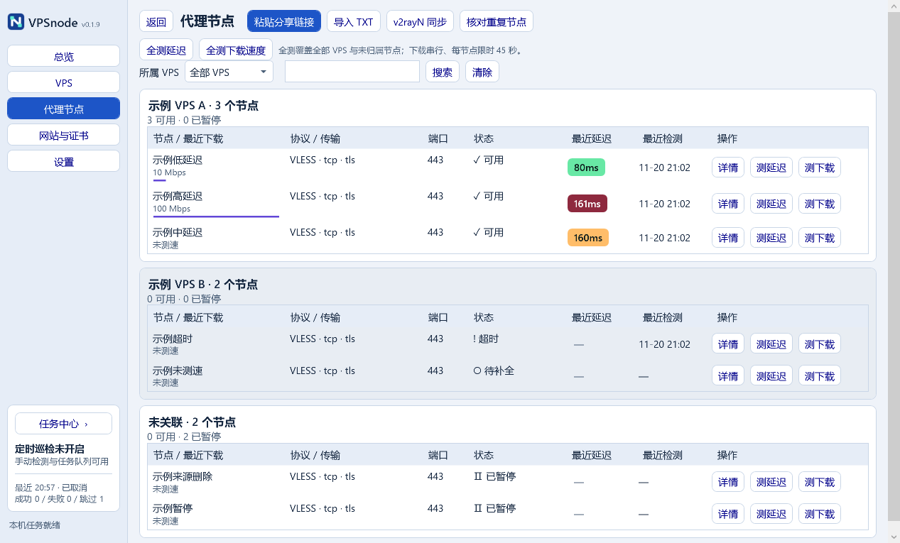
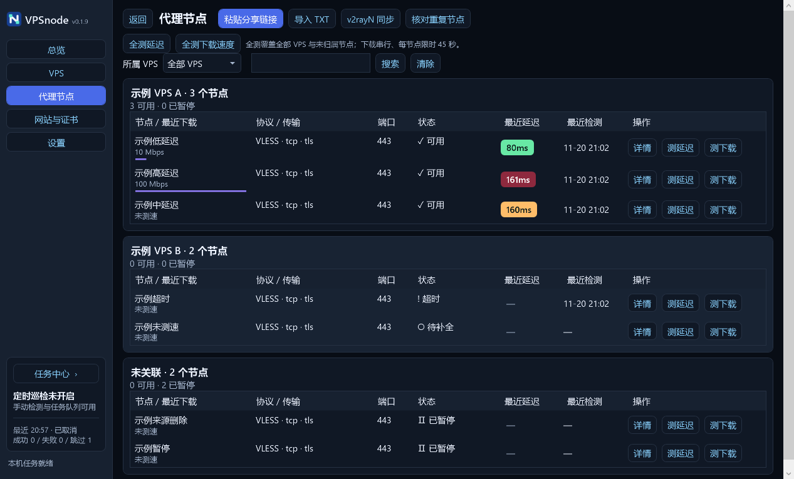

# VPSnode

A local Windows application for managing VPS hosts, proxy nodes, websites, and certificates.

Keep configuration sources, asset relationships, and inspection history together in a searchable network asset inventory.

[简体中文](README.md) · [Downloads](https://github.com/cloud-mk/VPSnode/releases) · [Issues](https://github.com/cloud-mk/VPSnode/issues)

## Features

- **Read-only VPS inventory:** collect host information, 3x-ui inbounds, clients, and fallback rules over SSH.
- **Multiple node sources:** import share links and synchronize local v2rayN configurations while preserving source information.
- **Identity-aware matching:** associate records using client identity, verified endpoints, and key parameters; review uncertain matches.
- **Websites and certificates:** check HTTP, HTTPS, and TLS certificates, and associate fallbacks using actual server-side rules.
- **Latency and download tests:** run individual or batch tests with recorded successes, failures, timeouts, skips, and cancellations.
- **Encrypted backups:** export assets, settings, and history; preview an import before merging or replacing local data.
- **Desktop and CLI:** use the Chinese-language desktop interface, light and dark themes, tray monitoring, or local command-line tools.

## Getting started

1. Download the Windows x64 MSI installer or portable ZIP from Releases.
2. Install the application, or extract the complete ZIP and run `VPSnode.exe`.
3. Select an existing v2rayN directory in Settings. Node tests reuse its proxy core.
4. Add a VPS, import share links, or synchronize v2rayN nodes.
5. Review the collected information and run checks as needed.

Release packages include the .NET runtime. Development validation used Windows 10 LTSC x64; other Windows versions have not undergone full acceptance testing. SSH inventory requires local OpenSSH, Python 3 on the remote host, and permission to read the relevant configuration. VPSnode does not install or modify remote services automatically.

Closing the main window keeps the application in the system tray. Exit through the tray menu or Settings. Release packages are currently unsigned.

## Understanding results

VPSnode records panel configuration, process startup files, listening sockets, and actual proxy requests as separate evidence.

**Configured does not mean listening, and listening does not mean usable.** A startup file does not prove the process's current in-memory configuration. Historical measurements are not live status. This version does not call the panel API.

Node names do not determine identity. Different client identities are not automatically merged. A custom sharing address alone does not establish a website fallback relationship.

## Data and privacy

The default data directory is `%LOCALAPPDATA%\VPSnode`. Set `VPSNODE_DATA` to use a separate directory.

Local data is protected with Windows DPAPI for the current user. Use encrypted backups to migrate data rather than copying the database directly.

Full backups use AES-256-GCM encryption and PBKDF2-SHA256 password derivation, with a password of at least 12 characters. Lost passwords cannot be recovered. External SSH private keys, OpenSSH configuration files, and proxy cores are not embedded; configure their paths after restoration. Back up existing data before a replacement restore.

Share links, QR codes, and individual node configuration exports may contain credentials. Remove server addresses, domains, UUIDs, passwords, private keys, and other personal information before sharing reports or screenshots. Public examples contain fictional data only.

Checks connect to your configured servers, websites, and test endpoints. Download tests consume traffic. Batch downloads run sequentially, with a 45-second limit per node and the configured byte limit.

## What's new in 0.1.10

- Update node test progress and results in place, preserving controls, selection, scrolling and manually resized widths.
- Share widths, native column ordering and horizontal scrolling across groups, with subtle header-only separators.
- Keep duplicate review open while reusable, read-only left/right configuration windows show actual sources and masked credentials.
- Defer conflicting associations. Preserve complete pre-association configurations in encrypted source snapshots, along with provenance, notes, history and relationships. External VPS and v2rayN configurations are not modified.

See [validation and limits](docs/validation-0.1.10.md). Screenshots below remain the unchanged v0.1.9 images.

## What's new in 0.1.9

- Consistent node hover and double-click navigation, selectable text, and inactive-selection cleanup.
- Per-node latency and download actions reuse the existing task pipeline and prevent duplicate submissions.
- Scheduled inspection is opt-in, including upgrades from settings without an explicit switch. Manual tasks, CLI queues, and maintenance remain available.
- Seven settings sections, exact decimal MB conversion, integer latency labels with original precision retained, and themed password fields.
- Cable-N branding, matching version labels, clearer task status, and horizontally scrollable narrow layouts.

Screenshots are captured from the running WPF interface using fictional assets and demonstration results.




## What's new in 0.1.8

- More complete collection of 3x-ui clients, transport settings, and fallback rules.
- Improved node identity matching, source associations, and history preservation.
- Encrypted full backups with import previews and merge or replace options.
- More reliable batch testing, including unassigned nodes, with task result tracking.
- Refined dark theme, latency badges, node grouping, and task center.

## CLI and building

Run `vpsnode-cli.exe help` for commands. Import asset JSON through UTF-8 standard input rather than exposing credentials in command-line arguments. See the [asset format](docs/inventory.md) and [fictional example](examples/inventory.example.json).

Building requires Windows x64, .NET 10 SDK, and PowerShell 7:

```powershell
dotnet build VPSnode.slnx -c Release
./build.ps1 -Output ../VPSnode-release
```

Choose a fresh output directory. MSI packaging additionally requires WiX 5; specify its executable with `-Wix`. See [development and testing](docs/development.md) for isolated test runs.

## Limitations and feedback

See the precise [0.1.10 validation scope](docs/validation-0.1.10.md). Physical multi-monitor DPI transitions, cross-computer restoration, clean-system installation/upgrade/uninstallation, and extended operation remain unverified. Protocol and parameter support depends on the local proxy core and configuration. Unrecognized or incomplete configurations require review and should not be treated as verified.

Please include the application version, reproduction steps, expected behavior, and sanitized error details when opening an issue. Do not upload real asset databases, backups, private keys, or share links.

## Author and license

Author: **cloud-mk**. Original project: [cloud-mk/VPSnode](https://github.com/cloud-mk/VPSnode).

Licensed under the [Apache License 2.0](LICENSE). Modifications and redistributions must comply with its attribution, change notice, and NOTICE requirements. See [NOTICE](NOTICE) for attribution and original project information, and [THIRD-PARTY-NOTICES.md](THIRD-PARTY-NOTICES.md) for third-party licenses.
