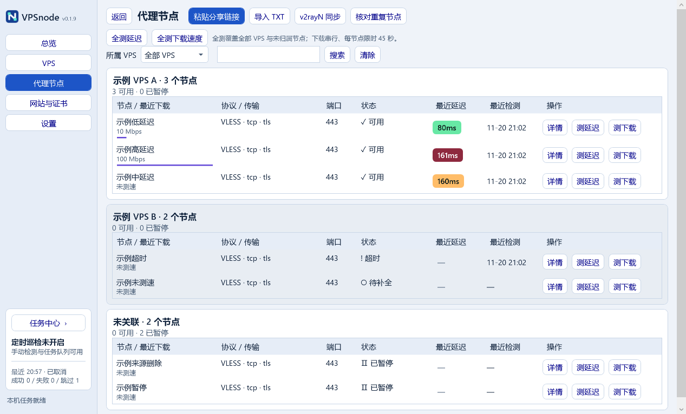
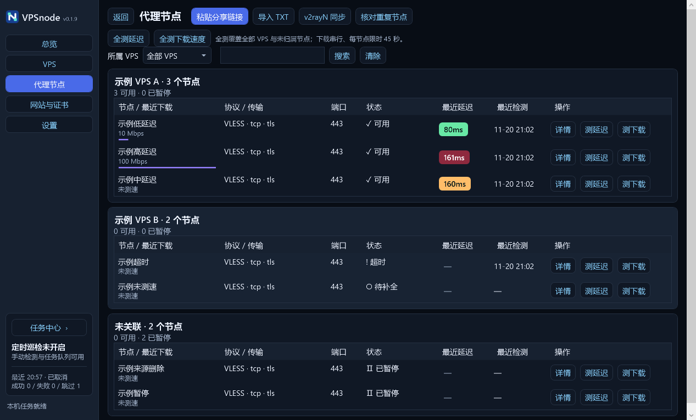

# VPSnode

初学者友好的 Windows 本地 VPS 与代理节点管理工具，配备可供 AI Agent 调用的 CLI，将网络运维成果变成可视、可核实的资产台账。

**Beginner-friendly · Visual · Agent-friendly · Verifiable**：普通用户用 GUI 独立管理，Agent 用 CLI 自动录入、维护和检测，双方查看同一份配置来源、关联关系与检测历史。

- **普通代理用户**：没有 VPS 也能使用；从分享链接或本机 v2rayN 导入节点，测速、查看配置并手动维护。
- **VPS 用户**：通过图形界面添加 VPS 或 SSH 别名，采集有权读取的服务器、入站和监听信息，管理网站、证书与检测结果。
- **Agent 用户**：使用 SSH、管理面板或其他工具完成远端运维，再用 VPSnode CLI 维护台账、执行检测、查询结果；GUI 让普通用户清楚看到并核对工作成果。VPSnode 专注本地资产与检测，不承担复杂远端部署编排。

[English](README.en.md) · [下载 / Releases](https://github.com/cloud-mk/VPSnode/releases) · [反馈 / Issues](https://github.com/cloud-mk/VPSnode/issues)

## 主要功能

- **VPS 盘点**：通过 SSH 只读采集主机信息、3x-ui 入站、客户端及回落规则。
- **多来源节点管理**：导入分享链接、同步本机 v2rayN，并保留各来源配置。
- **节点关联与去重**：结合客户端身份、端点和关键参数识别重复记录；不确定的情况提供差异核对。
- **网站与证书**：检查 HTTP、HTTPS 和 TLS 证书，依据实际服务端规则关联网站回落。
- **延迟与下载测试**：支持单节点和批量测试，记录成功、失败、超时、跳过及取消结果。
- **加密备份**：导出完整台账、设置和历史，预览后合并或替换恢复。
- **桌面与 CLI**：提供中文桌面界面、深浅主题、托盘巡检及本地命令行入口。

## 快速开始

1. 从 Releases 下载 Windows x64 MSI 安装包或便携 ZIP。
2. 安装后启动，或完整解压 ZIP 后运行 `VPSnode.exe`。
3. 在「设置」指定已有的 v2rayN 目录，节点测试复用其中的代理内核。
4. 添加 VPS、导入分享链接，或同步 v2rayN 节点。
5. 查看采集结果，按需执行延迟、下载及网站检测。

运行包包含 .NET 运行时，无需单独安装。开发验证环境为 Windows 10 LTSC x64；其他 Windows 版本尚未全面验收。SSH 盘点需要本机 OpenSSH、远端 Python 3，以及读取相关配置所需的权限。程序不会自动安装或修改远端服务。

关闭主窗口后程序保留在托盘；可通过托盘或设置退出。发行包暂未进行代码签名。

## 检测结果如何理解

VPSnode 分别记录面板配置、进程启动文件、实际监听和代理请求结果。

**已配置不等于正在监听，正在监听也不等于代理可用。** 启动文件不能证明进程当前的内存配置，历史测速也不代表实时状态。本版不调用面板 API。

节点备注不作为身份依据，不同客户端身份不会自动合并。自定义分享地址不能单独证明网站回落关系。

## 数据与隐私

默认数据目录为 `%LOCALAPPDATA%\VPSnode`，可通过 `VPSNODE_DATA` 指定独立目录。

本地数据使用 Windows 当前用户的 DPAPI 保护。跨电脑迁移请使用「设置 → 数据管理 → 导出加密备份」，不要直接复制数据库作为迁移方式。

全量备份使用 AES-256-GCM 加密和 PBKDF2-SHA256 口令派生，口令至少 12 字符；遗失口令无法恢复。外部 SSH 私钥、OpenSSH 配置及代理内核不包含在备份中，恢复后需重新配置相关路径。替换恢复前请先备份现有数据。

分享链接、二维码及单节点配置导出可能包含连接凭据。提交问题或截图前，请移除服务器地址、域名、UUID、密码、私钥及其他私人信息。公开示例仅使用虚构数据。

检测会连接你配置的服务器、网站和测试目标；下载测速会消耗网络流量。批量下载串行执行，每条最多 45 秒且受设置中的字节数限制。

## 0.1.11 更新

- Agent 可维护全部现有业务类别：资产增改删、来源同步、配置与重复核对、设置、备份和恢复；GUI/CLI 继续共用 Core、加密 SQLite 和检测器。
- 检测形成稳定任务 ID、持久进度、最终结果、失败原因及历史查询闭环。CLI 自动启动短生命周期本地 worker，GUI 未运行也能执行；两种入口共用执行锁与取消请求，不开放新端口。
- 所有共享表格统一浅色细表头分隔线，保留原生拖宽、列重排与节点页原位更新；同结构分组协调列宽。
- 直接呈现最近检测结果与原时间，不再按记录年龄降级；真实证书过期和提醒继续有效。

[Agent 使用指南](docs/agent-cli.md) · [GUI/CLI 覆盖矩阵及缺陷分析](docs/coverage-0.1.11.md) · [本版实际验收范围](docs/validation-0.1.11.md)。

## 0.1.10 更新

- 测速进度与结果原位更新，保留节点页、选中状态、滚动位置及手调列宽。
- 各 VPS 分组共用列宽、列顺序和水平滚动；表头增加轻量分隔线，数据行保持无竖线。
- 重复核对可同时打开左右只读配置窗口，重复点击复用，切换对象或关闭核对时清理附属窗口。
- 明确显示真实来源、缺失项与冲突；确认关联保留两侧完整加密配置快照、来源、备注和历史。明确冲突暂缓关联，不修改外部 VPS 或 v2rayN 配置。

[本版验收记录与限制](docs/validation-0.1.10.md)。以下界面图片沿用 v0.1.9，未替换为新截图。

## 0.1.9 更新

- 节点名称、协议、端口与状态支持悬停提示和双击详情；文字拖选、复制保留，失焦选区不再高亮。
- 行内提供「详情 / 测延迟 / 测下载」，共用任务队列和检测能力，运行中防止重复提交。
- 定时巡检默认关闭，旧配置也不自动启用；设置中可保存开关，手动检测、CLI 队列和维护保持可用。
- 设置按七个功能区整理；流量以 MB 显示，精确保留原始字节上限。
- 延迟统一显示整数 ms，原始检测值与分级依据保留；统一密码框深浅主题。
- 新增连线 N 图标、品牌版本号和任务中心分层布局；支持窄窗口横向滚动。

以下图片来自运行中的 WPF 界面，全部使用虚构资产与演示检测数据。




## 0.1.8 更新

- 完善 3x-ui 客户端、传输参数和真实回落规则采集。
- 改进多来源节点身份识别、关联和历史保留。
- 增加加密全量备份、导入预览和合并／替换恢复。
- 完善覆盖未归属节点的批量测速及任务结果记录。
- 优化深色主题、延迟标签、节点分组和任务中心。

## CLI 与构建

运行 `vpsnode-cli.exe help` 查看结构化命令帮助。资产 JSON 通过 UTF-8 标准输入导入，避免将凭据放入命令行。参阅 [Agent 使用指南](docs/agent-cli.md)、[资产格式](docs/inventory.md) 和 [虚构示例](examples/inventory.example.json)。

构建需要 Windows x64、.NET 10 SDK 和 PowerShell 7：

```powershell
dotnet build VPSnode.slnx -c Release
./build.ps1 -Output ../VPSnode-release
```

输出目录需为新目录。生成 MSI 还需要 WiX 5，通过 `-Wix` 指定其可执行文件。测试项目及隔离数据用法见 [开发与测试](docs/development.md)。

## 当前限制与反馈

本版验证范围见 [0.1.11 验收记录](docs/validation-0.1.11.md)。物理多显示器 DPI 切换、跨电脑恢复、干净系统安装／升级／卸载和长期连续运行尚未完成验收。协议与参数支持取决于本地代理内核和配置。未识别或不完整的配置需要进一步核对，不应视为已验证可用。

欢迎通过 Issues 提交缺陷和建议。请提供软件版本、复现步骤、预期结果及脱敏后的错误信息，不要上传真实资产数据库、备份、私钥或分享链接。

## 作者与许可

作者：**cloud-mk**。原始项目：[cloud-mk/VPSnode](https://github.com/cloud-mk/VPSnode)。

本项目采用 [Apache License 2.0](LICENSE)。修改和再分发时请遵守许可证中的署名、修改说明及 NOTICE 保留要求。原始出处与署名信息见 [NOTICE](NOTICE)，第三方组件许可见 [THIRD-PARTY-NOTICES.md](THIRD-PARTY-NOTICES.md)。
